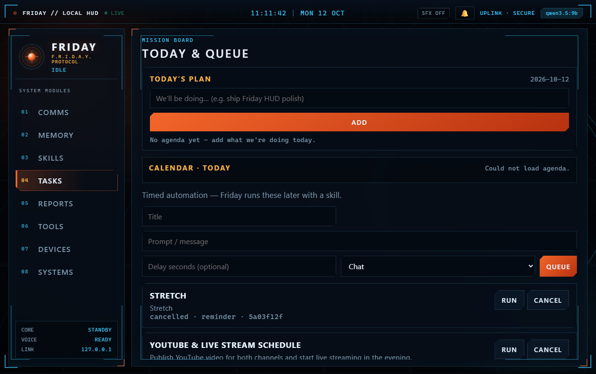
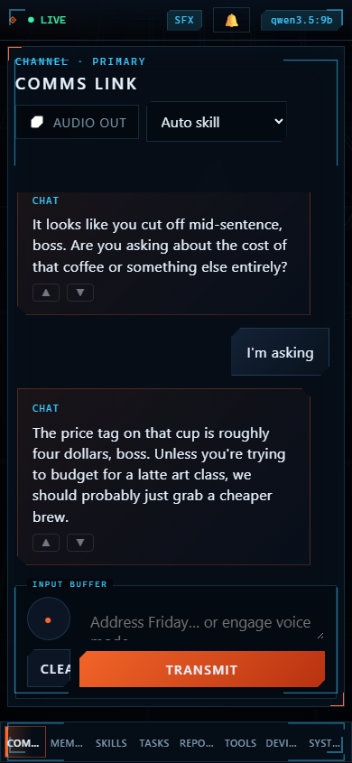

# Open Friday

Local-first personal AI assistant for Windows by **Sunil Kemadiya** ([Devoids](https://devoids.in)): modular **skills**, vector memory, voice, scheduled tasks, calendar hooks, and an optional **desktop agent** that observes the screen and acts one step at a time.

Talk to Friday in the Control Center; it routes to chat, research, memory, files, tasks, or **computer use** (vision or hybrid accessibility-tree backend). Everyday knobs live in **Systems** (owner profile, prefs, camera) — not scattered `.env` edits.

<p align="center">
  
</p>

---

## Features

| Surface | What it does |
|---------|----------------|
| **Control Center** | Web UI at `http://127.0.0.1:8787` — Comms, Memory, Skills, Tasks, Reports, Tools, Devices, Systems |
| **Skills** | Built-in packs: chat, computer_use, research, memory, files, tasks |
| **Memory** | Chroma + local embeddings — searchable from the UI |
| **Owner profile** | Systems → About you — durable context + upgrade notes Friday can capture |
| **Calendar & rhythm** | iCal agenda, morning briefing, focus nudges (local data) |
| **Voice** | Push-to-talk STT and TTS (optional install) |
| **Desktop agent** | Legacy vision loop or hybrid UIA+vision via Windows-MCP |
| **Safety** | Policy tiers, approvals, hash-chained audit log, emergency stop |

Mobile-friendly layout:

<p align="center">
  
</p>

---

## Requirements

- **Windows 11**
- **Python 3.14** (tested on 3.14.6)
- **[Ollama](https://ollama.com)** for local models
- **GPU:** NVIDIA recommended for vision models; 16 GB VRAM is a comfortable target for default quantizations
- Optional: **`uv`** on PATH for Windows-MCP (see below)

### Recommended Ollama models

Install these yourself (Friday does not pull models):

| Tag | Typical use |
|-----|-------------|
| `qwen3.5:9b` | Default chat / agent |
| `qwen3.5:4b` | Faster routing / lighter tasks |
| `qwen3-vl:8b-instruct` | Vision-heavy agent steps |
| `qwen2.5vl:7b-q4_K_M` | Alternate vision model |
| `nomic-embed-text` | Memory embeddings |
| `qwen3-coder:30b` | Optional coding tasks (VRAM permitting) |

Benchmark methodology and caveats: [`docs/benchmarks.md`](docs/benchmarks.md).

---

## Install and first run

### One-click (Windows 11)

```powershell
irm https://raw.githubusercontent.com/skemadiya2833/open-friday/main/deploy/windows/install.ps1 | iex
friday doctor
friday
```

Installs under `%LOCALAPPDATA%\OpenFriday`, adds a `friday` shim to your user PATH, and **does not** pull Ollama models unless you pass `-PullModels` / `-PullVision` (see [`deploy/windows/README.md`](deploy/windows/README.md)).

### Manual (developers)

```powershell
python -m venv friday_env
friday_env\Scripts\activate
python -m pip install --upgrade pip
pip install -r requirements/core.lock.txt
pip install -e .
copy .env.example .env

friday                  # tray + Control Center (same as python main.py)
friday --help           # also: friday doctor | friday version | friday serve --server
python main.py --server # HTTP only — http://127.0.0.1:8787/
```

CLI:

| Command | What it does |
|---------|----------------|
| `friday` / `friday serve` | Control Center + tray |
| `friday serve --server` | HTTP only |
| `friday doctor` | Preflight checks + next steps (never downloads models) |
| `friday doctor --json` | Machine-readable report |
| `friday version` | Print version |

Optional extras:

| Need | Install |
|------|---------|
| Voice | `pip install -r requirements/voice.lock.txt` |
| Camera (webcam) | `pip install -r requirements/camera.lock.txt` then `FRIDAY_CAMERA=on` + Arm in Systems |
| Dev / tests | `pip install -r requirements/dev.lock.txt` then `pytest` |
| Windows-MCP tools | Enable `windows` in `config/mcp_servers.yaml`; requires `uv` |

Regenerate locks after editing `requirements/*.in`:

```powershell
uv pip compile requirements/core.in --python-version 3.14 --python-platform windows -o requirements/core.lock.txt
```

---

## Security summary

- **Passkey auth** (`FRIDAY_AUTH=local`): loopback-only until a registrable hostname and trusted TLS cert are configured for phone access — see [`docs/PHONE_SETUP.md`](docs/PHONE_SETUP.md).
- **Request guard:** strict Host/Origin allow list; no wildcard CORS.
- **Tools:** `config/policy.yaml` — safe / confirm / deny tiers; shell off by default.
- **MCP:** disabled by default; pinned versions; dangerous tools excluded in config.
- **Before you push a fork:** `python scripts/pre_push_secrets_check.py` and `python scripts/pre_push_guard.py`.

Full detail: [`docs/THREAT_MODEL.md`](docs/THREAT_MODEL.md), [`SECURITY.md`](SECURITY.md).

Emergency stop: **Ctrl+Alt+F12** cancels agent runs and revokes approvals.

---

## Architecture and docs

- [`docs/ARCHITECTURE.md`](docs/ARCHITECTURE.md) — components and data flow
- [`docs/design/`](docs/design/) — feature design notes
- [`docs/PERSONA.md`](docs/PERSONA.md) — assistant tone and humor settings
- [`docs/ENV_FLAGS.md`](docs/ENV_FLAGS.md) — configuration reference

Optional Vite React shell (`web/src`): set `FRIDAY_ALLOWED_ORIGINS` for `http://localhost:5173` when using `npm run dev`.

Legacy entry points: `python main.py --gui` · `python main.py --cli "Open Notepad"`

---

## Roadmap

- Stronger phone / remote access ergonomics with documented TLS setup
- Optional SearXNG-backed research provider (design in `docs/design/searxng_provider.md`)
- Continued hybrid-agent hardening and benchmark coverage
- Community skill import with quarantine and hash-bound approval (see threat model)
- Opt-in local camera (v1 one-shot): [`docs/design/camera_assistant.md`](docs/design/camera_assistant.md)
- Releases: [`docs/RELEASE_CHECKLIST.md`](docs/RELEASE_CHECKLIST.md)

---

## Credits and license

Third-party projects and adapted code are listed in [`docs/REFERENCES.md`](docs/REFERENCES.md) and [`docs/THIRD_PARTY_NOTICES.md`](docs/THIRD_PARTY_NOTICES.md).

**License:** [MIT](LICENSE)

Maintainer: **Sunil Kemadiya** — [Devoids](https://devoids.in) · [skemadiya@gmail.com](mailto:skemadiya@gmail.com)

Contributions welcome — see [CONTRIBUTING.md](CONTRIBUTING.md).
